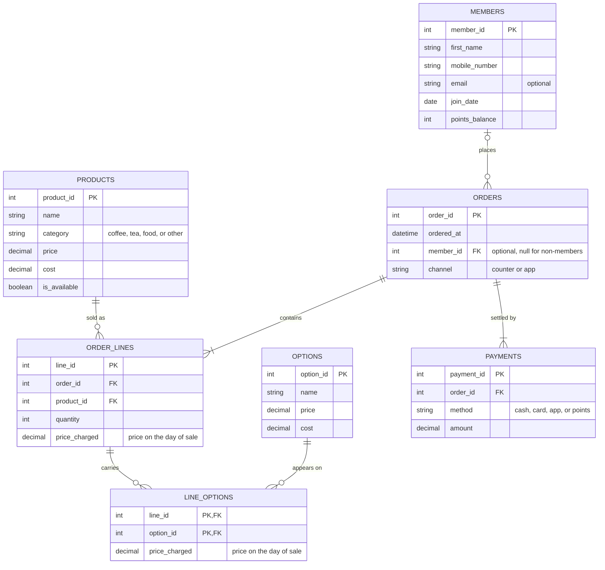

1. The Scenario. Which one you chose, A to D, or your own domain written out as described under E.

Im going to do the Babson Bean Cafe. The Members information would be connected to Orders, Orders would be connected also to Pay and Reciept/Information about the individual order. Order info would be connected to the Menu/Availability. 

2. The ERD. Every table, its columns, its primary key and its foreign keys, and every relationship with both of its ends marked, as a mermaid erDiagram. Put it between a line ```mermaid and a line ```, as below, and VS Code's preview and GitHub both show it as a diagram. Chapter A of the SQL handbook, §5, shows how to read one.



3. What One Row Means. One sentence for each table, in the way Northwind's would read: "One row of orders is one order placed by one customer."

- One row of `members` is one loyalty member signed up at Babson Bean.
- One row of `products` is one item on the menu.
- One row of `options` is one add-on a drink can carry.
- One row of `orders` is one order placed by a customer, member or not.
- One row of `order_lines` is one product on one order, with the quantity bought and the price charged that day.
- One row of `line_options` is one option added to one order line, with the price charged that day.
- One row of `payments` is one payment made toward one order.

4. Design Choices. Four short answers, in your own words. Which key you chose where the business already had one, such as an email or a ticker, and why. Which relationships are optional, and what in the scenario tells you so. Which of the scenario's rules your tables cannot hold, and how you will check it instead. And one thing your agent proposed for the design that you changed or did not take, and why; if you designed it alone, one thing you checked in the ERD your agent drew.