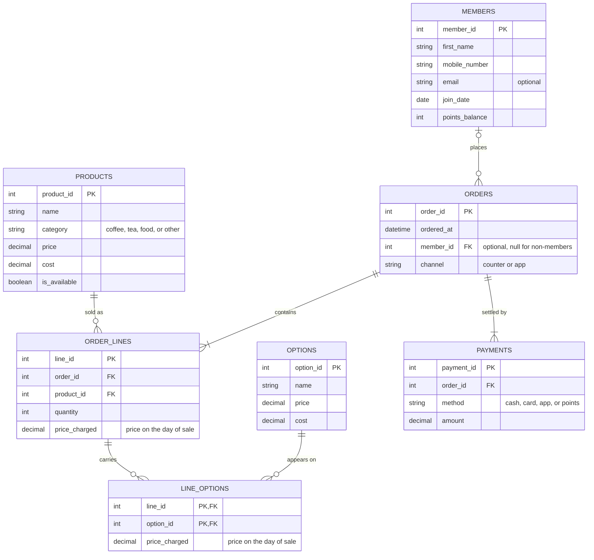

1. The Scenario. Which one you chose, A to D, or your own domain written out as described under E.

Im going to do the Babson Bean Cafe. The Members information would be connected to Orders, Orders would be connected also to Pay and Reciept/Information about the individual order. Order info would be connected to the Menu/Availability. 

2. The ERD. Every table, its columns, its primary key and its foreign keys, and every relationship with both of its ends marked, as a mermaid erDiagram. Put it between a line ```mermaid and a line ```, as below, and VS Code's preview and GitHub both show it as a diagram. Chapter A of the SQL handbook, §5, shows how to read one.



3. What One Row Means. One sentence for each table, in the way Northwind's would read: "One row of orders is one order placed by one customer."

One row of `members` is one loyalty member signed up at Babson Bean.
One row of `products` is one item on the menu.
One row of `options` is one add-on a drink can carry.
One row of `orders` is one order placed by a customer, member or not.
One row of `order_lines` is one product on one order, with the quantity bought and the price charged that day.
One row of `line_options` is one option added to one order line, with the price charged that day.
One row of `payments` is one payment made toward one order.

4. Design Choices. Four short answers, in your own words. Which key you chose where the business already had one, such as an email or a ticker, and why. Which relationships are optional, and what in the scenario tells you so. Which of the scenario's rules your tables cannot hold, and how you will check it instead. And one thing your agent proposed for the design that you changed or did not take, and why; if you designed it alone, one thing you checked in the ERD your agent drew.

  1. Members already have a phone number and email in the dataset, but these aspects can change. The Key I chose was member_id in MEMBER. I chose this because aspects like email and phone number of customer may change, but a unique member ID will never change.
  2. member_id in ORDERS is optional because customers who are not members can also buy coffee at the shop, so if they do not have a loyalty membership their order name will just be blank or no customer. Since it is possible for a member to join the loyalty program but never actually order, the MEMBERS to ORDERS relationship is also optional. ORDER_LINES to LINE_OPTIONS is also optional since a line can have many options or no options.
  3. The scenario rule my tables cannot hold is the CHECK rule. This CHECK constraint cannot look across tables, but "payments add up to the order's total" has to be numbers from different tables such as orders, order_lines, line_options, and payments. The query I will use to check it will be using SELECT that adds each orders lines and options to get what it should total, then adds up each orders payments to get what it actually paid, and then compares the two and lists the orders that do not match.
  4. The first time it wrote unit_cost under order_lines and cost_charged on line_options. But it wanted to not change the cost when it was sold, so which add-ons earn their keep wouldnt change if the price from the supplier changed so I dropped both of the columns. The margin can still be estimated from the cost column from products and options so if they coffee shop wants the exact margin those columns are the first thing thats added.

